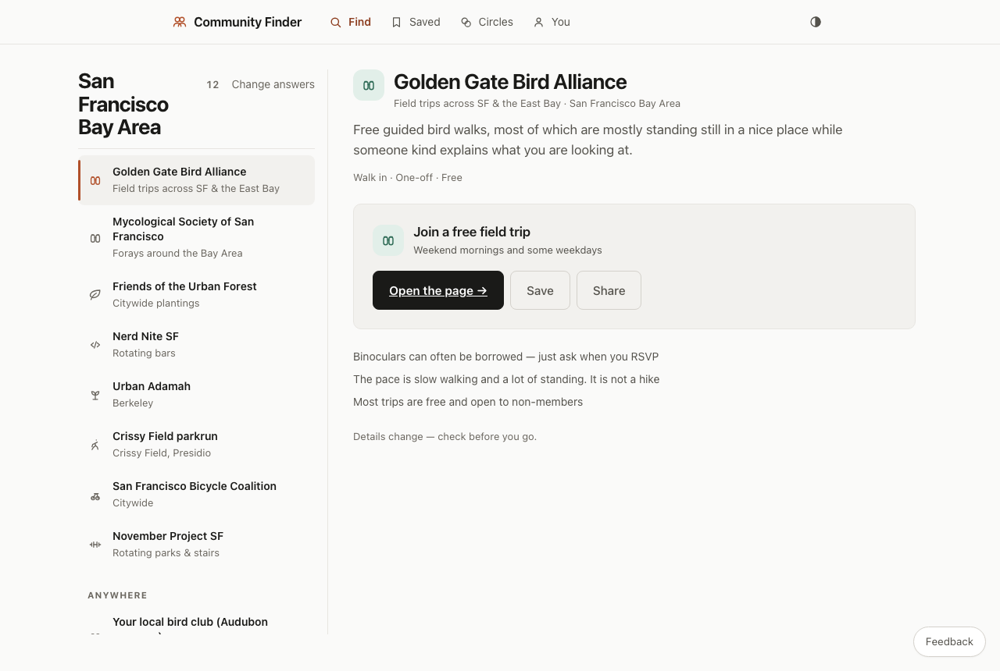
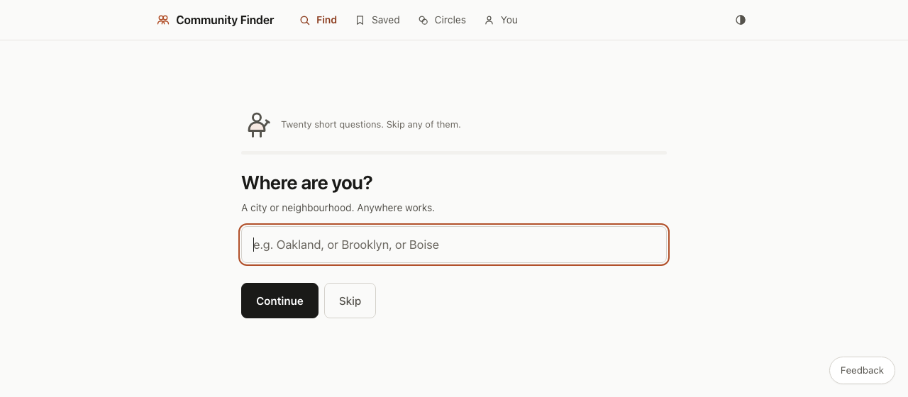
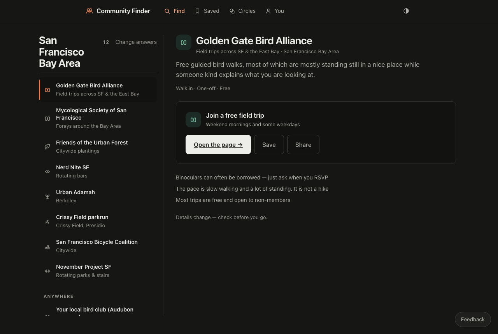
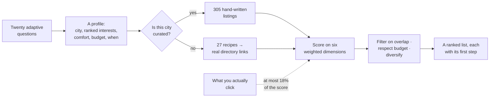

# Community Finder

For the problem of *"I live here and I don't know anyone."* It asks twenty
short questions and returns real local groups — each with the one thing you
cannot get without ringing round: **the concrete first step, what it costs,
what the commitment is, and what actually happens when you turn up.**

**[Open it →](https://amalmehta.com/community_finder/)**



Twenty questions, chosen one at a time. What you have already said decides what
comes next: pick "Give" and it asks what kind of useful; say a room of
strangers is hard and it asks what would make it easier. Once your chosen areas
are drilled out it probes the ones you skipped, at half weight — which is where
the surprises come from.



It assumes you are capable. It does not write your messages for you, reassure
you, or tell you it's okay to leave early. It tells you that the bird walk
lends binoculars, that the shelter wants an orientation first, that the league
places solo sign-ups on a team — the specifics that decide whether something is
worth your Saturday.

---

## What is in it

- **Thirteen cities are hand-curated** — the SF Bay Area, New York, Los
  Angeles, Chicago, Seattle, Austin, Boston, Philadelphia, Washington DC, San
  Diego, Denver, Portland and Minneapolis. 305 organisations, every link
  checked weekly by CI. Every city covers every one of the 32 interests, and
  the test suite enforces it.
- **Every other city works too.** A fallback engine builds live, working links
  into national directories — Meetup, VolunteerMatch, parkrun, Feeding America,
  CenterLink, Repair Café, Audubon, RRCA and more — pointed at the city you
  typed and the interests you picked.
- **And, with a server behind it, circles**: four to eight people in one city
  who share interests and one group chat. You talk first. Only once the circle
  has genuinely been a conversation does the app let anyone propose meeting —
  and then only if enough people say yes. Every mechanic in it comes from the
  group-dynamics literature, and the numbers are
  [pinned by tests](docs/SYSTEM-DESIGN.md#why-circles-work-the-way-they-do).

Dark mode is checked on every component:



## How it works



All of that runs in your browser. There is no build step, no dependency and no
network call — the listings are plain `<script>` tags, so `open index.html`
works off the disk. A service worker keeps a copy so it opens with no signal.
With a Node server behind it the same app adds accounts, circles and messages;
without one it falls back to the finder alone.

## Run it

```bash
open index.html
```

Or, to get the offline copy, accounts and circles:

```bash
npm start
```

Node 22+, no dependencies, nothing to install. Then <http://localhost:4000>.
There is a native Mac wrapper too — `npm run mac`.

```bash
npm test
```

Around 9,500 assertions over the data and the engines, then 460 against a real
HTTP server. Both expect `0 failed`.

## Where everything is

| | |
|---|---|
| **[Setting it up, running it, using it](docs/INSTRUCTIONS.md)** | Every command, checked by following it |
| **[System design](docs/SYSTEM-DESIGN.md)** | Architecture, flows, where data lives, decisions, threat model, limits |
| **[What is where](docs/FILE-STRUCTURE.md)** | Every file that matters, one line each |
| **[Deploying](DEPLOY.md)** | Docker, TLS, and the checklist before letting anyone in |
| **[The API](server/README.md)** | Routes, safety rules, rate limits |
| [Prompt log](docs/PROMPTS.md) | What was asked for in each session, and what it led to |
| [Privacy](privacy.html) · [Terms](terms.html) | What is stored, where, and who can see it |

## Privacy, briefly

Your answers, your saved list and the record of what you click are in your
browser and are never transmitted — with or without an account. The **You** tab
shows exactly what has been inferred and can pause or erase it. With an
account, the same tab will hand you everything the server holds about you as a
file, and delete the account outright. No analytics, anywhere, deliberately.

## Known limits

Thirteen curated metros; everywhere else gets national directories, which is
useful but not the same. Denver is the thinnest city — seventeen of its
thirty-two interests have exactly one listing. The data is a point-in-time
snapshot, so the weekly link check catches a dead URL but not a group that
still has a website and stopped meeting. The solo and gentleness ratings are
judgement, not measurement. Messages are plain text in SQLite, readable by
whoever runs the server, and the privacy page says so.

The longer list, including what the circles research does and does not
support, is in **[the system design doc](docs/SYSTEM-DESIGN.md#known-limits)**.
