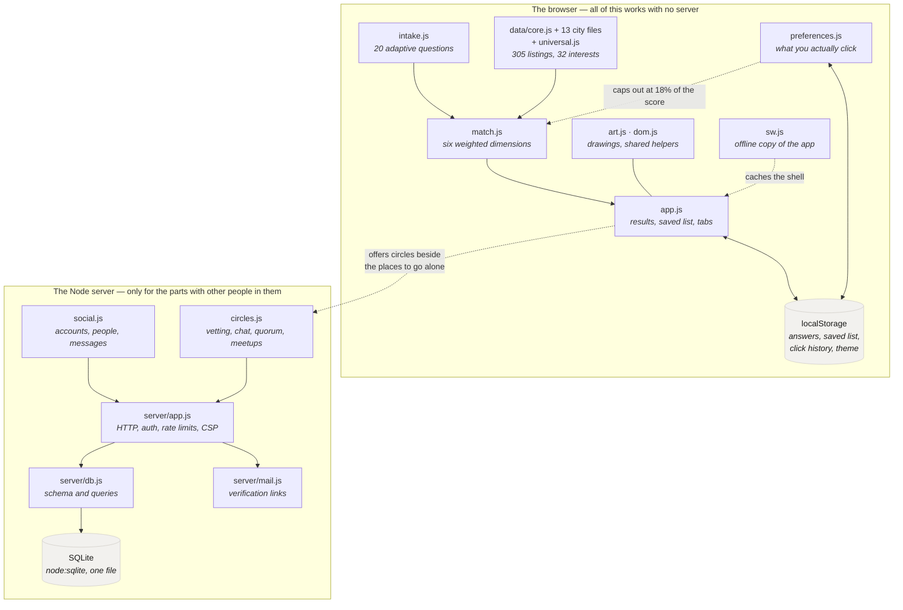
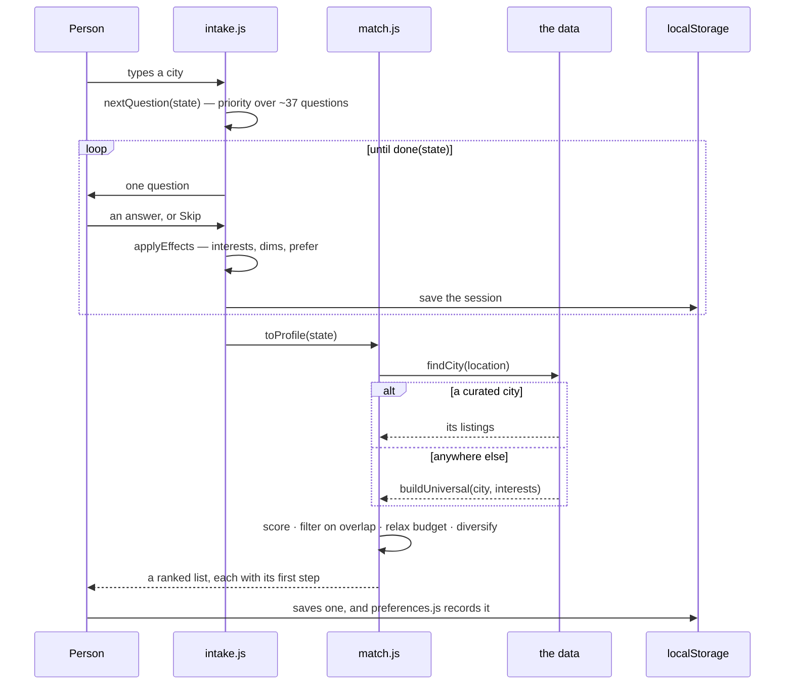
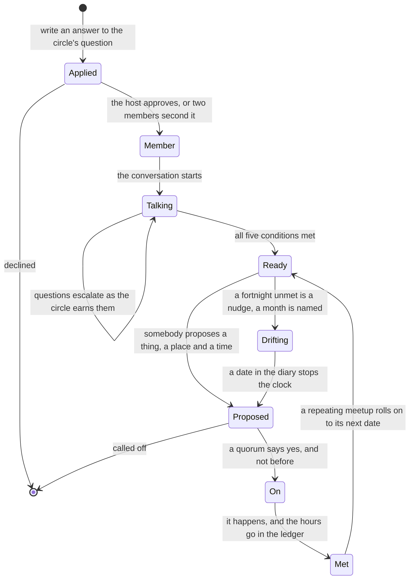

# System design

How Community Finder is put together, what each piece is for, where the data
lives, what was decided and why, and what it does not do.

- [The shape of it](#the-shape-of-it)
- [Components](#components)
- [The main flows](#the-main-flows)
- [Where data lives](#where-data-lives)
- [Key decisions](#key-decisions)
- [Why circles work the way they do](#why-circles-work-the-way-they-do)
- [Security and privacy](#security-and-privacy)
- [Scale](#scale)
- [How it is tested](#how-it-is-tested)
- [Known limits](#known-limits)

---

## The shape of it

One codebase, two builds. The finder runs entirely in the browser and needs
nothing behind it. Everything other people are in — circles, messages — needs
the server, and the front end finds out which build it is in by asking
`GET /api/me` once on load and falling back to solo mode if that fails.



The dotted lines are the only couplings worth naming: the learned profile can
only nudge the ranking, never drive it; the worker sits in front of the shell
and nothing else; and the finder's results offer circles without depending on
them existing.

## Components

### The browser half

| File | Its job |
|---|---|
| `src/data/core.js` | The interest taxonomy — 32 interests in 6 groups — the city registry, and the location matcher. Everything else reads from here. |
| `src/data/city-*.js` | Thirteen hand-curated metros, 305 organisations. Each registers itself with `FYC.addCity`, so adding a city means adding a file (and a line in `index.html` and `sw.js`). |
| `src/data/universal.js` | 27 recipes that build real, working deep links into national directories for any city nobody has curated. They produce the same shape a curated listing has, so everything downstream treats them identically. |
| `src/intake.js` | The adaptive form. Pure functions: a state object in, the next question out. No DOM, so it is tested in Node. |
| `src/match.js` | The scoring engine. A profile in, ranked and explained results out. Also pure. |
| `src/preferences.js` | What someone actually does — expands, opens, shares, saves, ticks off — turned into a weighted profile. Storage is injectable, so it tests without a browser. |
| `src/dom.js` | The helpers every screen needs: `el`, `api`, the view turnstile, the visibility-aware interval, the error line. One copy, because three copies had already drifted. |
| `src/app.js` | The finder's own screens: the form, the results list and detail pane, the saved list, the You tab, the theme, the back button. |
| `src/art.js` | Every drawing in the app, built as inline SVG at run time. Avatars, one pictogram per interest, five spot illustrations, a guide figure. |
| `src/social.js` | Accounts, discovery, one-to-one messaging. Inert with no backend. |
| `src/circles.js` | Circles: applying, the group chat, the readiness gate, meetups and RSVPs. |
| `sw.js` | The service worker. Caches the shell so the app opens with no signal. |

### The server half

| File | Its job |
|---|---|
| `server/app.js` | One HTTP server: routing, sessions, rate limits, the security headers, and the static files. No framework, no dependencies. |
| `server/db.js` | The schema and every query. `node:sqlite`, prepared statements, `tx()` for the writes that must be atomic. |
| `server/mail.js` | Verification mail. The default transport writes to `server/data/outbox/` so the whole flow works with no provider and no key. |
| `tools/` | The things an operator runs: the link checker, backups, the moderation console, the daemon wrapper, and the service-worker stamp. |

## The main flows

### Finding somewhere to go



Two things in there are easy to miss. The matcher **filters** on interest
overlap before it ranks — a listing matching none of your interests is not a
match, and the app says outright which interests the city has nothing
hand-picked for, rather than padding the list. And budget is a stated
constraint, so it filters, but it relaxes if that would leave you with almost
nothing.

### A circle, from application to meetup



The five conditions of the gate, enforced on the server (409, not a nudge):
three people, twenty messages, from three different people, across two separate
days, with nobody accounting for more than half of it.

## Where data lives

| What | Where | Who can read it |
|---|---|---|
| Your twenty answers, your saved list, what you have clicked, your theme | `localStorage`, this browser | You. It is never transmitted, with or without an account. |
| A copy of the app's own files | The service-worker cache, this browser | Nobody; it holds the app and nothing you typed. |
| Account, profile, interests and their visibility | `users`, `user_interests` | You, and — for the interests you marked visible — people discovery shows you to. |
| Connections and messages | `connections`, `messages` | The two people, and whoever runs the server. Plain text, not end-to-end encrypted. |
| Circles, applications, chat, vouches, meetups, RSVPs, attendance | `circles` and friends | The circle's members. An RSVP's if-then plan is shown to its author only. |
| Blocks and reports | `blocks`, `reports` | You, and whoever reads the reports. |
| Rate-limit counters | `actions` | Nobody; pruned after seven days. |

One SQLite file, WAL mode, foreign keys on. `tools/backup.js` takes a
consistent snapshot with `VACUUM INTO` while the server is running.

## Key decisions

**Zero build, zero dependencies.** Plain `<script>` tags and a global `FYC`
object; Node 22's built-in `node:sqlite` on the server. The cost is no module
system and no types. The gain is that `open index.html` works, the whole thing
is auditable in an afternoon, and there is no supply chain. For something
people are asked to trust with "I don't know anyone here", that trade is worth
making.

**Curated data, not an API.** 305 listings written by hand, each with a first
step, a cost, a commitment and what actually happens when you turn up. No API
gives you that, which is the entire product. The cost is decay, which is why
`tools/check-links.js` runs weekly in CI and opens an issue.

**The finder needs no account.** An account is asked for at the point you
reach for the parts other people are in, and never at the door. Your city and
interests come from the answers you already gave.

**Deterministic rules, no model.** Every score, every explanation and every
gate is arithmetic you can read. Reproducible, free to run, and explainable on
the card — "Matches Hiking + Birding" is true because the code says so.

**Pure functions where it matters.** `intake.js`, `match.js` and
`preferences.js` have no DOM and no I/O, which is why Back can replay a session
from scratch rather than keeping undo state, and why 9,000 assertions run in
Node in under a second.

**Network-first in the worker, not cache-first.** A deploy that hands people
new HTML driving old JavaScript was a real bug here once. The live copy wins
whenever there is one, with a 2.5-second stopwatch so a bad connection is not
worse than no worker — and a page that *does* come from the cache has its
scripts served from the cache too, so a load is always one build.

**Rate limits in the database, not in memory.** One row per limited action in
`actions`, pruned weekly. It survives a restart, and it gives a moderator
something to look at.

## Why circles work the way they do

Every mechanic in circles came out of the group-dynamics literature, and the
numbers are pinned by tests so they cannot drift away from what they cite.

| Mechanic | Where it comes from |
|---|---|
| The chat has a ceiling: nudged at 14 days, named as drifting at 28 | Ramirez & Zhang (2007) — partners who move online-to-offline late do *worse* than partners who never meet |
| Nobody may account for more than half the chat, and most of the circle has to be in it | Woolley, Chabris, Pentland, Hashmi & Malone (2010) — collective intelligence tracks the equality of conversational turn-taking |
| An hours ledger against 50 / 90 / 200, counting only confirmed time together | Hall (2018) — leisure hours, not messages, are what friendship costs |
| Meetups repeat by default | Adams — proximity, *repeated* unplanned interaction, somewhere safe to confide |
| Three escalating question sets, each unlocked by answering the one below | Aron et al. (1997) — the escalation is the mechanism, not the questions |
| A set only opens if two or more people *replied* | Reis & Shaver — disclosure builds closeness only when somebody responds |
| Everyone but the person concerned is told when an answer gets no reply | the same model: the disclosure happened, the response did not |
| Pairwise shared interests, and one-to-one threads inside a circle | Ren, Kraut & Kiesler (2007) — a group thread builds attachment to the *group*, not to its people |
| An if-then plan required on every yes | Gollwitzer & Sheeran (2006), 94 studies — when, where and how is most of the gap between meaning to go and going |
| Questions handed by name to members who have gone quiet | Preece, Nonnecke & Andrews (2004) — people who never post mostly have not been asked anything |
| A circle says what it is for in its members' own lines | Campbell (1958) on entitativity; Lickel et al. (2000); Postmes et al. (2005) on identity induced rather than handed down |
| Eight people at most, six by default | Fay, Garrod & Carletta (2000) — five holds a dialogue, ten becomes serial monologue |

**None of this reasoning appears in the interface.** The rule is state and
instruction, never justification: a circle says "4 of 5" and "all five before
anyone can propose a meetup", and says nothing about collective intelligence.

## Security and privacy

### The threat model

Who we are defending against, and what stops them.

| Threat | What stops it |
|---|---|
| Someone reading another person's conversation | Every route resolves the connection *for that user* (`connectionForUser`), never by id alone. Circle routes go through `requireMember`. |
| Mass-messaging lonely people | Introductions are request-then-accept. New accounts get 3 a day, established ones 10. Every route that writes a message counts against an hourly cap — including the two that used to leave a door open. |
| Session theft | `HttpOnly; SameSite=Strict; Path=/`, `Secure` under TLS. Expiry is enforced in the query, not just the cookie. Suspension deletes live sessions. |
| CSRF | `SameSite=Strict` plus an `Origin` check on every non-GET `/api/` request. |
| Brute force | 10 logins per IP per 15 minutes; 5 signups per IP per hour. Passwords are scrypt (N=16384) on libuv's threadpool, and an unknown username is hashed against a dummy so it costs the same as a real one. |
| Reading the server's own files | The static handler decodes once, normalises, strips leading `..`, checks an allowlist, and confirms the resolved path is under the web root. The database and `server/` are not reachable. |
| SQL injection | Every statement binds with `?`. The only interpolations are a placeholder count and a `PRAGMA table_info` over a hardcoded list. |
| XSS | `el()` sets `textContent` and has no way to pass markup. The one attribute that dispatches on its content — a meetup's anchor link — is checked for `http(s):` on the way in *and* on the way out. |
| A hidden interest being used to find you | Discovery and pairwise overlap both filter on `visible = 1` on both sides. |
| Rate limits being sidestepped by a header | `X-Forwarded-For` is ignored unless `TRUST_PROXY` says how many proxies are in front, and then counted from the right. |

### What is deliberately not defended

- **Messages are plain text in SQLite.** Not end-to-end encrypted. Anyone with
  access to the server can read them, which the privacy page says outright.
- **Verified email is not unique.** Two accounts can verify the same address,
  so the trust tiers are weaker than they look against somebody determined.
- **The vouch graph can be gamed by one person with three addresses.** Tier 3
  is reachable without an independent party.
- **`script-src 'unsafe-inline'`** is a real weakening, scoped to the theme
  script in the page head. Removing it needs a nonce pipeline and a build step.

## Scale

Sized for what this is: a few hundred to a few thousand people on one box.

| Decision | Right for today because | Change it when |
|---|---|---|
| One SQLite file, WAL | Reads are concurrent, writes are a trickle, and a backup is one `VACUUM INTO` | Sustained write concurrency. Postgres is the move, and `db.js` is the only file that changes. |
| One process, no cluster | The whole working set fits in memory and scrypt now runs off-thread | More CPU than one core can serve. `db.js` behind a pool first. |
| Polling, 5s open / 30s counts | Fewer moving parts than websockets; it pauses while the tab is hidden | A few thousand concurrent open conversations. Server-sent events next, not websockets. |
| 305 listings as `<script>` tags | ~400KB, cached by the worker, no fetch, works from `file://` | Past a few thousand listings. Split per city and load on demand. |
| Rate limits as database rows | Survives a restart; gives moderators an audit trail | `actions` becoming the hot table. It is pruned weekly and indexed on `(who, kind, at)`. |

## The interface

**One frame, five tabs: Find · Saved · Circles · Inbox · You.** On a wide
screen the tabs sit in the app bar; at 720px and under the same buttons become
a bottom bar, which is where a thumb is. Signing out is an account action and
lives on You, not in the navigation. People and Chats are two halves of one
Inbox, switched with a segmented control rather than being two destinations.

**Find is a list and a detail pane.** Every match is one row — a name and a
place — in a column that scrolls on its own, with the one you chose open
beside it in a pane that scrolls on its own. Under 900px there is room for one,
so choosing a row is a navigation and a back button appears. It replaced a
single column of cards that expanded in place, which gave a 1180px window to
one and a half results and reflowed the page under the cursor on every tap.

**An open circle is three panes — Chat · People · Plan** — and opens on the
chat. The readiness count rides on the Plan tab's label and ticks over as you
send, so the gate is visible without a copy of it under the composer.

**State and instruction, never justification.** A circle says "4 of 5" and
"all five before anyone can propose a meetup", and says nothing about
conversational turn-taking. The reasoning is in the source comments and in this
file, where it belongs — it was once roughly 1,200 characters of commentary on
the circles screen alone.

### The look

One typeface, one accent, a ground that asks for nothing.

Headings used to be set in a serif whose stems are thin, so a 22px heading read
*lighter* than the 14px bold sans in the list below it — the hierarchy was
upside down while both were at full-strength ink, which no colour change can
fix. Size and weight in one family say it without the argument.

The page was cream. A tinted ground makes every surface on it a decision: white
cards had to be lifted off it with a 26px shadow, the sunk tone had to be
browner still, and the accent had to shout over all of it. The ground is within
a few points of neutral now, a hairline border does what the shadow did, and
the corners came in from 18px to 10px.

Two colours were acting as accents. They have one job each:

| | means | where |
|---|---|---|
| **Accent** (terracotta) | *here*, or *do this* | progress through the form, the open listing, the rung you are on, links, focus |
| **Moss** | *earned*, *confirmed*, *done* | ticks, met conditions, a finished plan, a confirmed meetup |

The filled button is ink rather than the accent. When the loudest colour on the
page appears several times on every screen it marks nothing; ink is
unmistakably the thing to press, and it frees the accent to mean *here*.

The suite pins all of this: that nothing asks for the serif, that the ground is
within four points of neutral, that the accent is the one saturated token, and
that progress, the open listing and the current rung are the accent while ticks
and finished plans are moss.

### The back button

Five tabs and a detail pane, and Back used to leave the app from all of them.
In a browser tab that is rude; installed to a phone, where Back is the system
gesture, the only way out of Saved was to close the app and reopen it.

Changing tab and opening a listing are history entries now, written in the
`?tab=` vocabulary the installed shortcuts already use. A listing gets `?org=`,
which makes it linkable as well as returnable — and a cold `?org=` link works
on a first visit with no answers given: the id names a city and a set of
interests, which is enough to rank that listing's neighbours around it. Answers
already given win, and the seeded session is never saved, so a half-finished
intake survives someone following a link. Closing a detail pane walks the
history rather than hiding the pane, so the entry that opened it is consumed
rather than waiting to be replayed.

### Offline, and on paper

Everything the finder needs is already in the bundle. The only thing it ever
needed the network for was fetching its own files — which meant it failed at
exactly the moment it was most useful: standing outside the place, no signal,
wanting the first step it told you about.

- **The network is asked first, with a stopwatch on it**, for the reason under
  *Key decisions*. After 2.5 seconds the cached copy answers instead; the slow
  fetch still finishes and still updates the cache.
- **A page that came from the cache gets its scripts from the cache**, so a
  marginal connection cannot assemble a half-new, half-old shell.
- **Any URL under the app opens the app**, so the installed `?tab=plan`
  shortcut works with the radio off.
- **The API is never cached.** A stale answer about who is in a circle is a lie
  with a timestamp on it.
- **Scope is read off the worker**, not assumed to be the root, because the app
  is served from a subdirectory on Pages and from `/` by the Node server.
- **The precache is all-or-nothing**, which is the right failure — a
  half-cached app that boots and then dies on a missing city is worse. What
  makes it safe is a test asserting every file in the list exists *and* that
  nothing the three cached pages reference is missing from it.

Being offline is not a problem with the app, so it gets no warning tint. The
banner says the true thing: everything here still works, but the links out will
not. It never disables them — `navigator.onLine` is false behind some captive
portals and true on others.

The saved list also prints. `@media print` drops everything that only works by
being tapped, drops the colour, and prints each first step's address after it.

### The data layer

SQLite through `node:sqlite`, WAL mode, no ORM and no migrations framework —
columns added after the first release are listed in `db.js` and applied on open.

- **Statements are prepared once and kept.** Measured at ~109µs a call on the
  discovery query when the change was made, about 1.45× faster than
  recompiling. (The figures in this section are from the commits that made each
  change; they have not been re-taken since.)
- **`synchronous = NORMAL`**, which SQLite recommends with WAL: an fsync per
  write cost roughly 3.3× (346µs against 105µs). Still safe against the
  application crashing; what it gives up is the last transactions in a power
  cut. Worth knowing before changing it back.
- **`busy_timeout = 5000`**, because `tools/backup.js` runs `VACUUM INTO`
  against the live file and a write in that window used to fail rather than
  wait.
- **Multi-table writes run in a transaction.** The dangerous ones are the
  clear-then-replace pairs: `setInterests` deletes every row and inserts the
  replacements, so a failure between the two left *nothing*. `tx()` begins
  inside its own try, so a failed `BEGIN` cannot leak the depth counter and
  silently turn every later transaction into no transaction at all.
- **Pruning** runs at startup and hourly: rate-limit actions older than a week,
  expired sessions, and spent or expired verification rows — that last one
  holds an email address and used to be kept forever.

Every query on a hot path is index-backed, and `EXPLAIN QUERY PLAN` is asserted
in the suite for the ones that were not. `meetups` and the sender-and-kind
lookups on `circle_messages` were the most recent two to get one.

## How it is tested

Two suites, no framework, no dependencies.

```bash
npm test
```

**`tests/run-tests.js`** — around 9,500 assertions over the data, the pure
engines and the source itself. Every listing has a valid first step, an https
URL, interests that exist and ratings in range — including all 27 fallback
recipes, which go through the same card. City lookup and its regressions
(`'la'` is inside Dallas; "Portland, Maine" is not Los Angeles). Matcher
behaviour: a nervous person gets gentle options first, budget is respected, the
comfort dial measurably re-ranks. The intake terminates however it is answered
and its progress bar reaches the end of every run. The service worker is run
for real in a VM under a subpath. And every text token is checked against every
surface it sits on, in both palettes, for a contrast ratio of 4.5:1.

**`tests/run-server-tests.js`** — around 460 assertions against a real HTTP
server on a throwaway database: signup, sessions, the request/accept/message
flow, outsiders locked out, blocking, reporting, rate limits, the whole life of
a circle, and a group of regression tests for defects that were reproduced
before they were fixed — an unlimited message flood, a cookie that made every
route 500, a PATCH that blanked a profile, a declined connection that collided
with its own unique index.

Plus `npm run links`, which fetches every URL in the dataset. CI runs the
suites on every push and the link checker weekly, opening one issue when the
world moves on.

## Known limits

- **Thirteen cities are curated; everywhere else gets national directories.**
  Honest, and said on screen, but a directory is not a hand-checked listing.
- **Denver is the thinnest city.** Seventeen of its thirty-two interests have
  exactly one listing, so picking one of those shows you a single group. The
  suite now reports per-city depth so this is visible at review time.
- **The solo and gentleness ratings are judgement, not measurement.** They
  drive the comfort matching and nobody has checked them against what people
  actually find easy to walk into.
- **The data is a point-in-time snapshot.** The weekly link check catches a
  dead URL; it cannot catch a group that still has a website and stopped
  meeting.
- **No password reset**, because no email is collected at signup. A forgotten
  password means a new account.
- **No horizontal scaling, and no analytics anywhere**, both deliberate.

### And the limits of the circles argument

Every mechanic above cites something. None of them measures what it cites, and
the gaps are worth stating.

- **A circle needs three people before it can plan anything**, so a new city
  starts cold. That is the honest cost of refusing to seat strangers at a table
  on day one.
- **The drift thresholds (14 and 28 days) are a judgement call.** Ramirez &
  Zhang established the *direction* — late switches go worse — in a lab, not
  the crossover point in weeks.
- **Hours are self-reported.** Someone can claim a meetup they skipped; the
  only check is that two people confirm before it counts as the circle's hours
  rather than one person's.
- **"Two people replied" is a crude stand-in for "the room responded".** Reis
  and Shaver's point is about perceived understanding, which no amount of
  counting messages detects. A circle could answer two questions dismissively
  and still climb a rung.
- **The if-then plan is checked against nothing.** Nobody verifies the bus
  exists or that you got on it. The research is about writing the plan down.
- **One-to-one threads cut both ways.** They are the mechanism that turns a
  group into friendships, and they are also how a group quietly becomes two
  people and some bystanders. The gate is about safety, not about that.
- **The turn-taking check counts messages, which is not what Woolley et al.
  measured.** They recorded speaking turns and had coders rate social
  sensitivity; a message count cannot see that two of the four voices are
  saying "agreed" and nothing else. It is a floor against the obvious failure,
  not a measure of a balanced conversation.
- **A circle can fail that check honestly.** A host who answers everything
  because they are the only one with answers is counted the same as one who
  will not stop talking, and the only remedy offered to either is to post a
  question and wait.
- **Naming the quiet people can land badly.** Somebody who reads happily and
  never posts is now addressed by name in front of everyone, and "no
  obligation" is a sentence rather than a guarantee. Two at a time, never twice
  running — and no way to opt out of it yet. That last part is the gap.
- **What a circle says it is for is free text with nothing checking that the
  lines have anything to do with each other.** Lickel's shared goals are
  *actually* shared; eight people writing eight different things is what this
  would show, honestly, and it would still read as a group.
- **Vetting is the host's judgement plus two seconds.** A real filter, not a
  background check. Nothing here verifies that anyone is who they say.
- **Contact details are organisation contact *pages*,** never scraped personal
  email addresses — in the finder and in a meetup's anchor alike.
